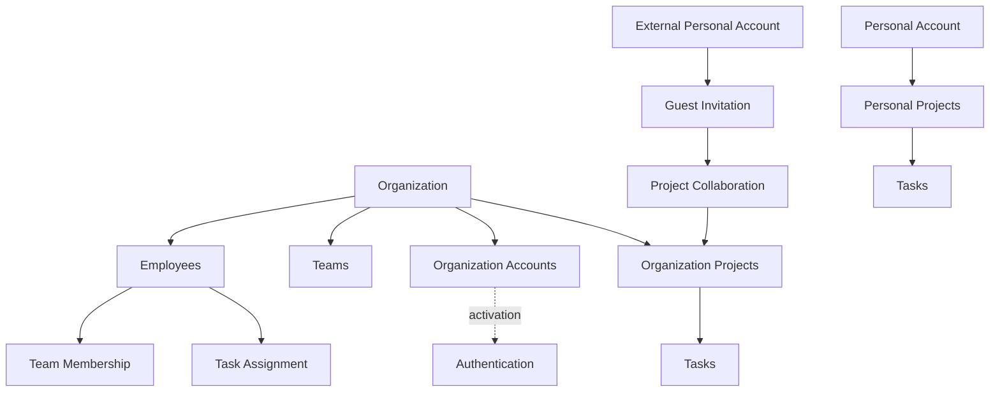

# Sangam – Domain Model

## 1. Purpose

This document defines the core business concepts (domain entities) of Sangam and their relationships.

The domain model represents the real-world concepts that the application needs to manage.

It serves as the foundation for:

- Database design.
- Entity relationship modelling.
- Backend domain entities.
- API design.
- Business logic implementation.

This is an evolving document. Entities and relationships may change as requirements become clearer.

## 2. Core Domain Concepts

### 2.1 Personal Account

**Purpose:** Represents an independent account created and managed by an individual.

Characteristics:

- Created through personal registration.
- Independently authenticated.
- Independently managed by its owner.
- Can own personal projects and tasks.
- Can invite collaborators.
- Is not controlled by an organization.

### 2.2 Organization

**Purpose:** Represents a company or business entity using Sangam.

An organization can:

- Manage its organizational information.
- Create employee records.
- Provision employee accounts.
- Organize employees into teams.
- Manage projects and tasks.
- Control access and permissions.
- Invite external collaborators.

### 2.3 Organization Account

**Purpose:** Represents an account provisioned and managed within an organization's environment.

Characteristics:

- Created or provisioned by the organization.
- Can exist before employee activation.
- Uses organization-managed authentication policies.
- Has an independent lifecycle.
- Can be activated or deactivated by authorized organization administrators.

### 2.4 Employee

**Purpose:** Represents a person in an organization's workforce.

Important characteristics:

- An employee record belongs to an organization.
- It can exist without an activated Sangam account.
- It can participate in organizational planning.
- It can be assigned tasks before account activation.
- Its employment lifecycle is independent of account activation.

An employee record and an organization account must not be treated as the same concept.

### 2.5 Authentication Identity

**Purpose:** Represents the authentication mechanism associated with an account.

Potential authentication mechanisms:

- Email and password.
- Google.
- Microsoft.
- Enterprise Single Sign-On.

Personal and organization accounts will maintain independent authentication contexts.

The exact authentication architecture remains subject to detailed design.

### 2.6 Employee Team Membership

**Purpose:** Represents the relationship between an employee and a team.

Examples:

- Engineering.
- Testing.
- DevOps.
- Human Resources.

An organization can have multiple teams.

**Pending decision:** Whether an employee can belong to multiple teams or only one primary team.

### 2.7 Project

**Purpose:** Represents a unit of work managed within a personal or organization environment.

A project can contain:

- Tasks.
- Project collaborators.
- Comments.
- Deadlines.
- Activity history.

A project belongs to one clearly defined ownership environment.

Users can participate in multiple projects, subject to authorization.

### 2.8 Task

**Purpose:** Represents an actionable unit of work within a project.

Potential attributes:

- Task ID.
- Project ID.
- Title.
- Description.
- Status.
- Priority.
- Due date.
- Created by.
- Assigned employee.

A project can contain multiple tasks.

Tasks can be assigned to active employees even if their Sangam accounts have not yet been activated.

### 2.9 Project Comment

**Purpose:** Represents discussion or feedback associated with a project or task.

Comments should preserve their historical author association and context.

### 2.10 External Collaborator

**Purpose:** Represents an external personal account invited to collaborate on an organization-owned resource.

Characteristics:

- Remains independent of the organization account domain.
- Must be explicitly invited.
- Must verify the appropriate identity.
- Receives resource-specific permissions.
- Can have access revoked by the organization.

### 2.11 External Collaboration Invitation

**Purpose:** Manages invitations sent to external personal accounts.

Potential attributes:

- Invitation ID.
- Organization ID.
- Project ID.
- Invited email.
- Invitation status.
- Invited by.
- Expiration date.
- Accepted date.

An invitation does not automatically establish active collaboration access.

### 2.12 Project Collaborator

**Purpose:** Represents a user's authorized participation in a project.

Potential attributes:

- Collaborator ID.
- Project ID.
- Account reference.
- Permission level.
- Status.
- Joined date.

Initial guest permission levels:

- VIEWER.
- CONTRIBUTOR.
- ADMINISTRATOR, where explicitly authorized and appropriate.

External collaborators receive VIEWER permission by default.

### 2.13 Project Transfer Request

**Purpose:** Manages requests to move a project from a personal environment to an organization environment.

Potential attributes:

- Transfer ID.
- Project ID.
- Source environment.
- Target organization.
- Requested by.
- Approved by.
- Transfer status.
- Requested date.
- Completion date.

A transfer requires authorization and destination organization approval.

The transfer must preserve appropriate project history and re-evaluate access permissions.

## 3. Important Domain Distinctions

### 3.1 Personal Account vs Organization Account

Personal and organization accounts are independent.

They have separate:

- Account identities.
- Authentication contexts.
- Ownership.
- Administration.
- Lifecycle management.
- Authorization policies.

No automatic account linking or merging will occur.

### 3.2 Employee vs Organization Account

An employee represents a workforce record.

An organization account represents application access.

An employee can exist without an activated organization account.

### 3.3 Invitation vs Membership

An invitation represents a request to join or collaborate.

A successful invitation acceptance establishes the appropriate access relationship.

A pending invitation must not automatically grant access.

### 3.4 Task Assignment vs Account Activation

Task assignment is based on an employee's organizational status.

Account activation determines whether the employee can authenticate and access Sangam.

These are independent concerns.

## 4. High-Level Domain Relationships

The following is a conceptual representation of the current design direction.

This diagram is conceptual. Exact database relationships and cardinalities remain to be finalized.

## 5. Initial Business Rules

### Personal Accounts

1. Individuals can create personal accounts independently.
2. Personal accounts are not owned or administered by organizations.
3. Personal projects remain under personal ownership unless an authorized transfer is completed.

### Organization

1. An organization can maintain employee records independently of account activation.
2. Organizations manage their own employees, teams, projects, and policies.
3. Organization data must be protected from unauthorized access.

### Employees

1. Employee records can exist before account provisioning.
2. Organization accounts can be provisioned before activation.
3. Active employees can receive task assignments before account activation.
4. Inactive employees cannot receive new task assignments.
5. Historical assignments must be preserved.

### Guest Collaboration

1. Organizations can invite external personal accounts.
2. Guest access must be explicitly approved.
3. Guest permissions are resource-specific.
4. VIEWER is the default guest permission.
5. Permission upgrades require authorization.
6. Guest access can be revoked.

### Project Transfer

1. Projects have a clearly defined owner.
2. Transfers require authorization.
3. Destination organization approval is required.
4. Project history and data integrity must be preserved.
5. Permissions must be re-evaluated after transfer.

## 6. Proposed Logical Modules

| Module           | Responsibility                               |
| ---------------- | -------------------------------------------- |
| Personal Account | Personal registration and account management |
| Organization     | Organization creation and administration     |
| Identity         | Authentication and identity management       |
| Employee         | Employee records and lifecycle               |
| Team             | Team management and memberships              |
| Project          | Project management                           |
| Task             | Task creation and assignment                 |
| Collaboration    | Comments and external collaboration          |
| Document         | Document and knowledge management            |
| AI               | AI-powered capabilities                      |

These are logical module boundaries, not separate microservices.

## 7. Pending Architectural Decisions

| ID     | Question                                                                       | Status            |
| ------ | ------------------------------------------------------------------------------ | ----------------- |
| DM-001 | Can employees belong to multiple teams?                                        | PENDING           |
| DM-002 | Can an organization have employees without organization accounts indefinitely? | PENDING           |
| DM-003 | Can personal workspaces have multiple collaborators?                           | PENDING           |
| DM-004 | What is the detailed organization account provisioning process?                | PENDING           |
| DM-005 | Can external collaborators access multiple projects?                           | PENDING           |
| DM-006 | What happens to task assignments when employees become inactive?               | PARTIALLY DECIDED |
| DM-007 | What are the exact project permission levels?                                  | PENDING           |
| DM-008 | How should employee email changes be handled?                                  | PENDING           |

## 8. Document Status

**Status:** Initial conceptual model.

This document represents the currently discussed requirements and design direction.

It is not the final database schema.

Entities, attributes, relationships, and constraints must be validated before implementation.

All accepted changes must be reflected in this document.
